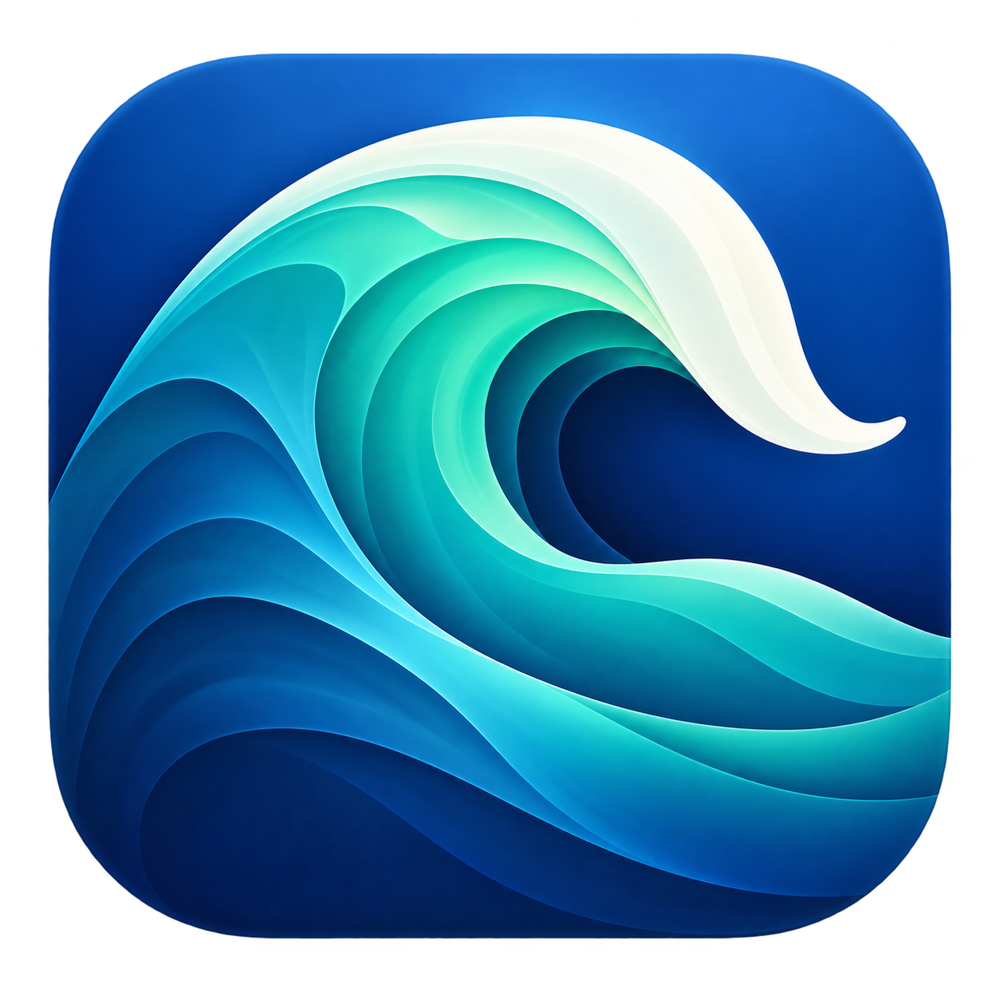

  

# MavericksResurrection

Install OS X Mavericks 10.9.5 directly onto an existing internal or USB partition. **No USB installer is needed.**

MavericksResurrection downloads and prepares Mavericks using MavericksForever, installs it, and applies the patches needed for the MacBookPro11,4 or MacBookPro11,5. It also includes optional NVMe support and a fix for audio breaking after software updates.

**[Download 1.0 Beta 4](https://github.com/jaegermeister-dev/MavericksResurrection/releases/tag/v1.0-beta.4)**

## Before you start

**Back up anything important. The partition you select will be erased.** The app asks you to confirm three times and reformats that partition as Mac OS Extended (Journaled). It does not create, resize or delete partitions.

Keep a working newer macOS installation available. You'll use it to run the app, repair post-update issues and manage NVMe support.

## Compatibility

- **MacBookPro11,5:** tested, including direct installs to the internal NVMe SSD and a USB drive, software updates, audio repair, and NVMe removal/reinstallation.
- **MacBookPro11,4:** supported by the app, but untested on hardware.
- **Macs that officially support Mavericks:** the app can install Mavericks without the extra model patches. A normal Apple installer is recommended for these Macs. If this app doesn't work, use the normal installation method; support is limited to the 11,4 and 11,5.
- Other unsupported Mac models are not supported.

The app targets **macOS Monterey 12 through macOS Tahoe**. It has been tested on Monterey and Tahoe. If something goes wrong on another version, try Monterey and include logs from both attempts in your report.

**Creating a Mavericks installation on a USB drive from an Apple silicon Mac has not been tested.** Any resulting installation would be for a compatible Intel Mac.

## Install Mavericks

1. Prepare a partition in Disk Utility as **Mac OS Extended (Journaled), not case-sensitive**, and make sure it's mounted before opening the app.
2. Download and extract the ZIP, then open **MavericksResurrection.app**. If macOS blocks it, approve opening it through macOS's security settings.
3. Choose to download and build a new MavericksForever image, or reuse one previously saved by MavericksResurrection.
4. Confirm the model identifier of the Mac that will run Mavericks. Select the destination partition and check its name, capacity and free space carefully.
5. Choose whether to include experimental NVMe support, then complete the confirmations and administrator prompt.
6. When installation finishes successfully, restart, hold **Option (Alt)** and select your Mavericks installation.

If you keep an installer image for reuse, leave it and its records in Application Support. Don't move, rename or modify the retained original. You can copy it elsewhere. The app also offers optional integrity checks.

## Read this before booting with HDMI

In my testing, the **MacBookPro11,5 would not boot Mavericks with HDMI connected to the laptop's own HDMI port**. It could show a white screen or kernel panic. Disconnect it before booting and connect it after reaching the desktop.

HDMI connected through my dock worked during boot. That only describes **my 11,5 and the specific dock I tested**; other docks may behave differently. I have not confirmed either HDMI arrangement on the 11,4. It may work fine, but I'd still advise leaving HDMI disconnected until Mavericks has booted. If a dock causes startup trouble, disconnect its HDMI cable or the dock itself until you're at the desktop.

## Experimental NVMe support

One High Sierra-based NVMe driver is included. It works with the **Apple SSD SM0256L tested in a MacBookPro11,5**, including after Mavericks updates and audio repair. It has also passed sustained read/write testing.

It's intended to support standard third-party NVMe drives too, but those results are still unconfirmed. **The release is a beta because compatibility with other NVMe drives still needs testing.**

SATA drives normally don't need this option. A Mavericks installation on USB can boot without it, but may need it to access an internal NVMe SSD. If you're preparing an installation for another Mac, remember the storage check describes the Mac running the app.

You can use **Install experimental NVMe support** or **Remove experimental NVMe support** on an existing Mavericks installation without reinstalling Mavericks. Removing it from an installation that boots from NVMe can prevent that installation from booting until you add it back from your newer macOS.

## Fixing audio after updates

Mavericks updates can remove working speakers, microphone and HDMI audio. If that happens:

1. Boot back into the newer macOS where you run MavericksResurrection.
2. Choose **Fix post-update issues** and select the affected Mavericks installation.
3. Let the repair finish, then boot Mavericks again.

The repair has been tested on both internal and USB installations with NVMe support present.

## A window appeared again after I already continued past it

**If you see a window appear that you already progressed past, just ignore it.** Don't interact with it or close it, as that may interfere with the process. Installation and repairs continued successfully despite these windows during testing, and they should disappear on their own. Follow progress in the main window.

This means leftover confirmation or selection dialogs, sometimes with an empty list. It does **not** mean you should ignore actual error messages.

## Reporting a problem

Use **Diagnostic logs…** to choose a folder for a saved log before reproducing the issue. **Collect installation diagnostics…** can also collect information from an installed Mavericks volume.

[Open an issue](https://github.com/jaegermeister-dev/MavericksResurrection/issues) with your Mac model, host macOS version, SSD model, whether the destination is internal or USB, what happened, and the logs. Support is provided for the **MacBookPro11,4 and MacBookPro11,5 only**.

## Credits

The original [MavericksForever](https://mavericksforever.com/) script was created by **Wowfunhappy**. **MavericksResurrection and its bundled adaptation are maintained by Jaegermeister-dev.**

Please report issues with MavericksResurrection here, **not to Wowfunhappy**. They did not make this application and are not responsible for maintaining it.

OS X, macOS and the included Apple components belong to Apple. Existing third-party attributions are retained in the app.
