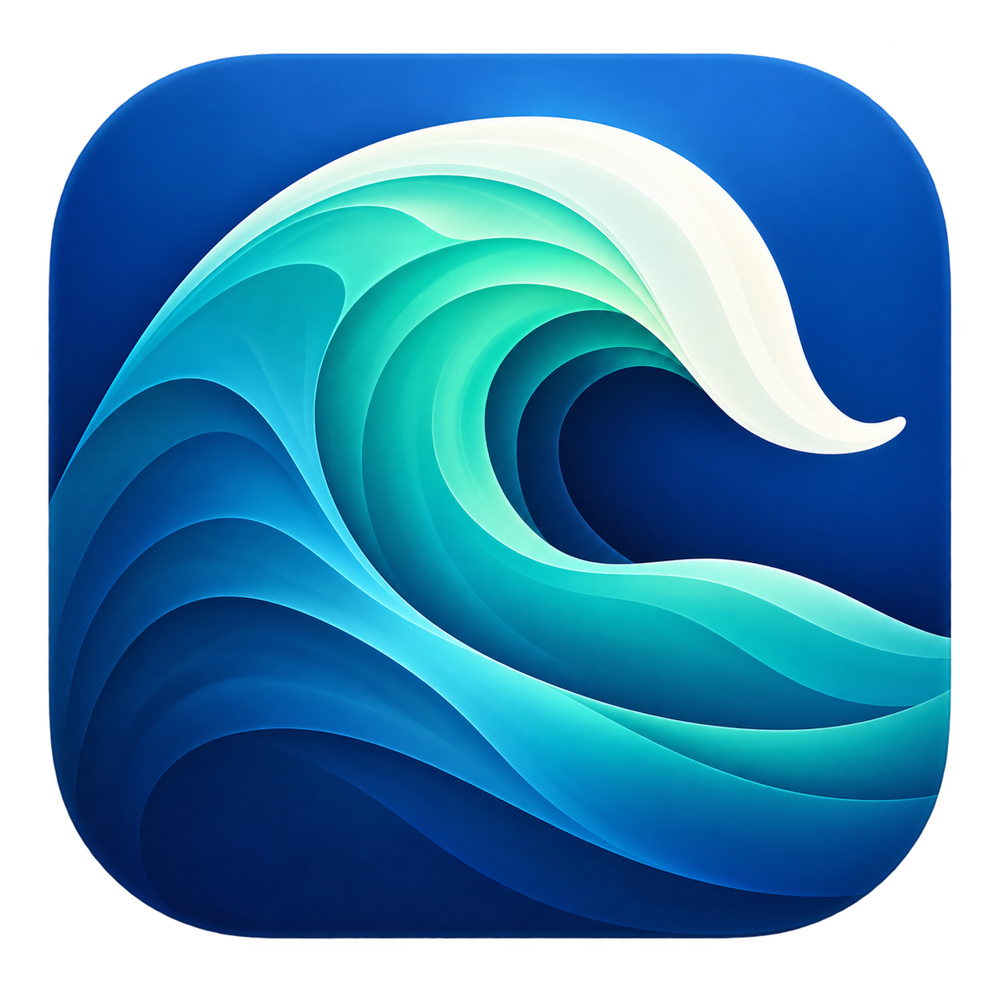

  

# MavericksResurrection

Install OS X Mavericks 10.9.5 directly onto an existing internal or USB partition. **No USB installer is needed.**

MavericksResurrection downloads and prepares Mavericks using MavericksForever, installs it, and applies the patches needed for the MacBookPro11,4 or MacBookPro11,5. It also includes optional NVMe support and a fix for audio breaking after software updates.

**[Download 1.0 Beta 8](https://github.com/jaegermeister-dev/MavericksResurrection/releases/tag/v1.0-beta.8)**

## Source code

The source and build instructions for Beta 8 are included in this repository. The published source builds the release download byte for byte with the recorded toolchains. See [SOURCE.md](SOURCE.md).

The source was first published with Beta 6.1 after a user pointed out that it was missing. Older downloads were removed following memory leak reports and because they had no accompanying source. Beta 6.1 remains available.

## Before you start

**Back up anything important. The partition you select will be erased.** The app asks you to confirm three times and reformats that partition as Mac OS Extended (Journaled). It does not create, resize or delete partitions.

Keep a working newer macOS installation available. You'll use it to run the app, repair post-update issues and manage NVMe support.

## Compatibility

- **MacBookPro11,5:** tested, including direct installs to the internal NVMe SSD and a USB drive, software updates, audio repair, and NVMe removal/reinstallation.
- **MacBookPro11,4:** the Intel framebuffer fix is applied automatically. Tests cover booting, accelerated graphics, Retina scaling, HDMI video and audio, internal speakers and microphone, and repair after software updates.
- **Macs that officially support Mavericks:** the app can install Mavericks without the extra model patches. A normal Apple installer is recommended for these Macs. If this app doesn't work, use the normal installation method; support is limited to the 11,4 and 11,5.
- Other unsupported Mac models are not supported.

The app runs on **macOS Big Sur 11 and newer**. Installation has been tested from Big Sur with SIP enabled, Monterey, and Tahoe.

**GPU switching on the MacBookPro11,5 is still being investigated.**

**Creating a Mavericks installation on a USB drive from an Apple silicon Mac has not been tested.** Any resulting installation would be for a compatible Intel Mac.

## Install Mavericks

1. Prepare a partition in Disk Utility as **Mac OS Extended (Journaled), not case-sensitive**, and make sure it's mounted before opening the app.
2. Download and extract the ZIP, then open **MavericksResurrection.app**. If macOS blocks it, approve opening it through macOS's security settings.
3. Choose to download and build a new MavericksForever image, or reuse one previously saved by MavericksResurrection.
4. Confirm the model identifier of the Mac that will run Mavericks. Select the destination partition and check its name, capacity and free space carefully.
5. Choose whether to include experimental NVMe support, then complete the confirmations and administrator prompt.
6. When installation finishes successfully, restart, hold **Option (Alt)** and select your Mavericks installation.

If you keep an installer image for reuse, leave it and its records in Application Support. Don't move, rename or modify the retained original. You can copy it elsewhere. The app also offers optional integrity checks.

## Read this before booting with HDMI

**On both MacBookPro11,4 and MacBookPro11,5, disconnect HDMI from the laptop and any dock before booting Mavericks. Connect it after reaching the desktop.**

In my 11,5 testing, HDMI connected during boot caused a white screen, kernel panic or failed startup. Dock HDMI worked in earlier tests, but a later boot failed with it connected and succeeded after it was disconnected, so it is not a reliable workaround. HDMI video and audio have been tested on the 11,4 after booting.

## Experimental NVMe support

One High Sierra-based NVMe driver is included. It works with the **Apple SSD SM0256L tested in a MacBookPro11,5**, including after Mavericks updates and audio repair. It has also passed sustained read/write testing.

It's intended to support standard third-party NVMe drives too, but those results are still unconfirmed. Compatibility with other NVMe drives still needs testing.

SATA drives normally don't need this option. A Mavericks installation on USB can boot without it, but may need it to access an internal NVMe SSD. If you're preparing an installation for another Mac, remember the storage check describes the Mac running the app.

You can use **Install experimental NVMe support** or **Remove experimental NVMe support** on an existing Mavericks installation without reinstalling Mavericks. Removing it from an installation that boots from NVMe can prevent that installation from booting until you add it back from your newer macOS.

## Fixing issues after updates

Mavericks updates can remove working speakers, microphone and HDMI audio. On the 11,4, updates can also overwrite the Intel graphics fix and break Retina scaling. After installing updates:

1. Boot back into the newer macOS where you run MavericksResurrection.
2. Choose **Fix post-update issues** and select the affected Mavericks installation.
3. Let the repair finish, then boot Mavericks again.

On the 11,5, the repair has been tested on internal and USB installations with NVMe support present. On the 11,4, graphics, scaling and internal audio were checked after repair on an internal non-NVMe SSD.

If Wi-Fi has no internet after installing updates or running **Fix post-update issues**, forget the Wi-Fi network and reconnect.

## Display scaling and update checks

Both the 11,4 and 11,5 receive the Retina display profile during installation. **Fix post-update issues** checks it and restores it if needed. Scaling was verified against a native 11,3. On the 11,4, the fixer also restores the Intel framebuffer patch; no experimental setting is needed.

The app can notify you about new releases. **Download** opens that release's GitHub page; the app does not download or install its own updates. You can skip a version or disable checks in **Preferences**.

## A window appeared again after I already continued past it

**If you see a window appear that you already progressed past, just ignore it.** Don't interact with it or close it, as that may interfere with the process. Installation and repairs continued successfully despite these windows during testing, and they should disappear on their own. Follow progress in the main window.

This means leftover confirmation or selection dialogs, sometimes with an empty list. It does **not** mean you should ignore actual error messages.

## Debug tools (advanced users)

Use the **Debug — Advanced users only…** button:

- **Read-only filesystem and installation diagnostics:** select the affected Mavericks partition. The app unmounts it normally, reads it without applying patches or repairs, checks the filesystem with repairs disabled, and leaves it unmounted. The report ZIP goes on your Desktop. Normal unmounting can flush writes macOS already has pending.
- **EFI diagnostics:** select the Mavericks partition and the EFI partition where you want the tool and logs saved. One EFI offers either diagnostics only, or diagnostics followed by a separately confirmed boot attempt. Existing OpenCore and boot files are preserved. Logs always stay on the EFI partition the tool runs from.
- **Collect EFI reports:** after the test, return to your working macOS and use this option to save a Desktop ZIP to share with your observations.

For the EFI test, use your existing **OpenCore EFI with OpenShell**, or install OpenCore EFI separately using [OCLP](https://dortania.github.io/OpenCore-Legacy-Patcher/BUILD.html). You can install it for testing even if your current macOS does not need it. This app does not install or configure OpenCore or OpenShell. The generated instructions identify your selected partitions and the correct tool path; follow those instead of assuming a particular `fs0:` mapping.

The EFI reports cover firmware information and boot-loader checkpoints. They cannot save the entire Mavericks kernel console after handoff, so photograph or record the last screen if booting fails. A boot attempt can write to disks; preserve a damaged installation before trying it. OpenCore can also affect the boot environment, so use the same route when comparing results.

Reports can contain hardware identifiers, usernames and file paths. Review them before sharing; nothing is uploaded automatically.

## Reporting a problem

Use **Diagnostic logs…** to choose a folder for a saved log before reproducing the issue. **Collect installation diagnostics…** can also collect information from an installed Mavericks volume.

[Open an issue](https://github.com/jaegermeister-dev/MavericksResurrection/issues) with your Mac model, host macOS version, SSD model, whether the destination is internal or USB, what happened, and the logs. Support is provided for the **MacBookPro11,4 and MacBookPro11,5 only**.

## Credits

The original [MavericksForever](https://mavericksforever.com/) script was created by **Wowfunhappy**. **MavericksResurrection and its bundled adaptation are maintained by Jaegermeister-dev.**

Please report issues with MavericksResurrection here, **not to Wowfunhappy**. They did not make this application and are not responsible for maintaining it.

OS X, macOS and the included Apple components belong to Apple. Existing third-party attributions are retained in the app.
